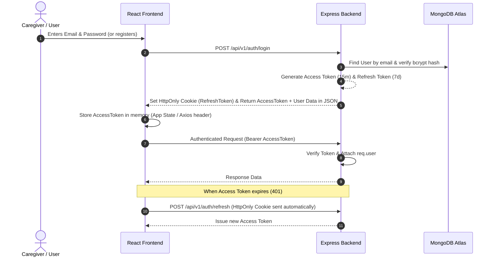
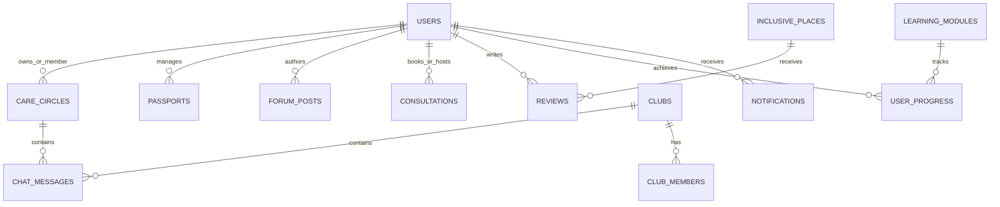
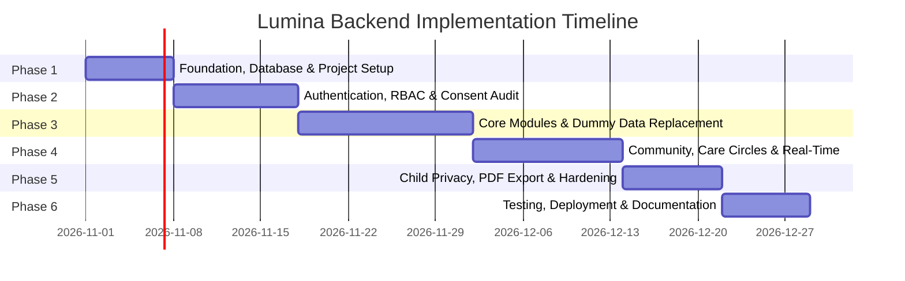

# Project Lumina — Backend Implementation Blueprint (`BACKEND_TASKS.md`)

> **Document Status:** Comprehensive Specification & Execution Blueprint  
> **Target Platform:** Project Lumina (Community Operating System for Neurodivergent Children & Families)  
> **Prepared For:** Project Owner / Lead Developer  
> **Root Workspace:** `d:\New folder\lumina-frontend\frontend`  
> **Document Version:** 1.0.0 (Production Blueprint)

---

## Executive Summary & Framework Audit

Before specifying backend tasks, a line-by-line inspection of the existing codebase was conducted to determine its actual technical foundation, directory structure, and dependencies.

### Codebase Reality vs. Initial Assumptions

| Technical Dimension | Assumed in Prompt | Actual Codebase Reality (`package.json`, `craco.config.js`, `src/`) |
| :--- | :--- | :--- |
| **Framework** | Next.js (App Router / Pages Router) | **React 19.0.0 SPA** bootstrapped with **Craco 7.1.0** (`@craco/craco`) and `react-scripts 5.0.1` |
| **Language** | TypeScript / JavaScript | **JavaScript (ES6+) with JSX** (`.js`, `.jsx`). No TypeScript config (`tsconfig.json`) exists |
| **Routing** | Next.js File-System Routing / Server Actions | **React Router DOM 7.15.0** (`BrowserRouter`, `Routes`, `Route` in `src/App.js`) |
| **Styling & UI** | Tailwind CSS / Shadcn | **Tailwind CSS 3.4.17** + 46 Radix UI primitives (`src/components/ui/`) + Lucide React |
| **State Management** | Server Components / Cookies | **React Context API** (`src/context/AppContext.jsx`) + Browser `localStorage` |
| **Current Data Source** | Dynamic APIs | **Static Mock Dataset** (`src/lib/mockData.js`, 463 lines of dummy objects) |
| **Existing Backend** | None connected | `.env` has a placeholder `REACT_APP_BACKEND_URL`, but no active backend logic exists |

### Architectural Recommendations

Because the existing frontend is a **functional React 19 Single-Page Application (SPA)**, two viable backend architectures exist:

1. **Option A (Recommended — Native MERN Stack):**  
   Retain the existing React 19 frontend as a client SPA and build a dedicated **Node.js / Express.js / MongoDB** backend server (`lumina-backend`).  
   - **Why:** Preserves 100% of existing UI components, Craco configurations, Tailwind styling, and React Router navigation without rewriting client code. Provides a clean separation of concerns, native WebSocket support (via Socket.IO) for community club chats and care-circle messaging, and straightforward deployment on low-cost nonprofit infrastructure (e.g., Node.js on Render/Railway/Fly.io + MongoDB Atlas).
2. **Option B (Next.js 15 App Router Full-Stack Migration):**  
   If the team strictly requires a single unified repository with Next.js Route Handlers and Server Actions, the frontend must be migrated from React Router DOM to Next.js App Router (`/app` directory).  
   - **Trade-off:** Requires rewriting routing (`useNavigate` -> `useRouter`, `<NavLink>` -> `<Link>`), converting client context providers, adjusting Radix UI hydration, and configuring serverless WebSocket workarounds (e.g., Pusher or Ably, since serverless Next.js Route Handlers cannot host persistent Socket.IO connections without an external server).

*This blueprint is designed primarily for **Option A (Node.js + Express + MongoDB REST & Real-Time API)** while providing complete mapping for **Option B** should migration be chosen.*

---

## 1. Existing Frontend Overview

### Project Directory Structure
```text
frontend/
├── .env                       # Environment placeholder (REACT_APP_BACKEND_URL)
├── craco.config.js            # Build config overriding webpack & dev server
├── package.json               # React 19, react-router-dom 7, radix-ui, tailwindcss
├── tailwind.config.js         # Theme colors (#5E8B7E, #E08A6E, #D9A441, #4F8A9E)
├── public/                    # HTML template, favicons, static images
└── src/
    ├── App.js                 # Router definition (<Shell>, <Routes>, 10 routes)
    ├── App.css / index.css    # Tailwind directives & CSS variable tokens
    ├── components/
    │   ├── Layout.jsx         # Desktop sidebar, header, global search, mobile drawer
    │   ├── LuminaLogo.jsx     # Brand SVG component
    │   ├── shared.jsx         # PageHeader, PillarBanner, ScoreRing, DemoTag
    │   ├── Welcome.jsx        # 2-step role onboarding wizard & age verification
    │   └── ui/                # 46 Radix UI / Shadcn accessible components
    ├── constants/testIds/     # Automated testing selectors (auth, home, etc.)
    ├── context/
    │   └── AppContext.jsx     # Global state: theme, language, onboarding, user, passport
    ├── hooks/
    │   └── use-toast.js       # Toast notification hook (Sonner wrapper)
    ├── lib/
    │   ├── mockData.js        # Centralized dummy dataset (463 lines)
    │   ├── sections.js        # Navigation pillars (Learn, Connect, Navigate, Support, Include, Empower)
    │   ├── translations.js    # Multi-language dictionary (English, Hindi, Odia)
    │   └── utils.js           # cn() class utility (clsx + tailwind-merge)
    └── pages/
        ├── Dashboard.jsx      # Daily stats, pillar shortcuts, progress overview
        ├── Learn.jsx          # Educational modules, tabs, government schemes
        ├── Lesson.jsx         # Single module lesson view, video embed, completion
        ├── Connect.jsx        # Care circles, caregiver chat, clubs, forum, peer networking
        ├── ClubChat.jsx       # Real-time community club chat interface with moderation
        ├── Navigate.jsx       # Professional directory, distance filtering, simulated map
        ├── Support.jsx        # AAC speech board, crisis helpline, consultation booking
        ├── Include.jsx        # Autism-friendly places directory, sensory ratings, reviews
        ├── Empower.jsx        # Digital Autism Passport editor, sharing, mentor network
        └── Profile.jsx        # User account details, accessibility switches, preferences
```

### Current Data Flow & Simulated Interactions
Currently, all dynamic data is imported synchronously from `src/lib/mockData.js`. State mutations are simulated using local React `useState` hooks, disappearing upon page refresh:
- **Onboarding (`Welcome.jsx`):** Role selection and age checkbox write to `localStorage.getItem("lumina_onboarded")`. No passwords, credentials, or server sessions exist.
- **Forum Posting (`Connect.jsx`):** New posts prepend to an in-memory array (`setPosts`).
- **Care Circle & Club Chat (`Connect.jsx`, `ClubChat.jsx`):** Chat messages append to local React state; messages do not persist and cannot be seen by other users.
- **Consultation Booking (`Support.jsx`):** Date/time selector triggers a `sonner` toast notification without recording a booking in any database.
- **Autism Passport (`Empower.jsx`):** Edits update `AppContext.jsx` in memory; PDF export and link copy only trigger simulated toasts.
- **Reviews (`Include.jsx`):** Submitting place reviews adds to an in-memory array with no moderation or persistence.

---

## 2. Complete Feature Inventory

The following table documents every module discovered in the existing codebase:

| Feature / Module | Frontend Location | Current Behavior | Required Backend Functionality | Priority |
| :--- | :--- | :--- | :--- | :--- |
| **User Onboarding & Auth** | `src/components/Welcome.jsx`, `src/context/AppContext.jsx` | 2-step mock flow (role selection + age checkbox). Sets `lumina_onboarded: "true"` in `localStorage`. | User signup, email/password login, JWT issue/refresh, role assignment, parental consent log, password reset. | **P0 (Critical)** |
| **User Profile & Settings** | `src/pages/Profile.jsx`, `src/components/Layout.jsx` | Displays mock `USER`. Modal edits display name in local state. Switches toggle local preferences. | Profile fetch/update (`/api/v1/users/me`), accessibility preference sync, avatar upload, account deactivation/deletion. | **P0 (Critical)** |
| **Dashboard Aggregation** | `src/pages/Dashboard.jsx` | Renders static stats from `TODAY_STATS`, `HOW_HELPS`, and `LEARN_PROGRESS` (65%). | Dynamic dashboard summary endpoint aggregating user unread alerts, upcoming consultations, and real learning progress. | **P1 (High)** |
| **Learning Hub & Modules** | `src/pages/Learn.jsx`, `src/pages/Lesson.jsx` | Renders `LEARN_MODULES` from `mockData.js`. Tabs display static text. YouTube iframe embeds video. | Learning module CRUD, language filtering (`en`, `hi`, `or`), category filtering, government schemes database. | **P1 (High)** |
| **Lesson Progress Tracking** | `src/pages/Lesson.jsx` | "Mark as Completed" button triggers a toast and redirects after 1500ms. No persistence. | User lesson progress tracking (`completed`, `percent`, `lastWatchedPosition`), course completion certificates. | **P1 (High)** |
| **Care Circle Collaboration** | `src/pages/Connect.jsx` | Displays static `CARE_CIRCLE` (goal, progress, members, updates). | Care circle management: create circle, invite professionals/teachers by email/code, track shared developmental goals. | **P1 (High)** |
| **Care Circle Private Chat** | `src/pages/Connect.jsx` | Controlled input adds messages to local array `setMessages`. Private to single browser tab. | Persistent multi-user chat room restricted to authorized circle members, message timestamps, read receipts. | **P1 (High)** |
| **Community Clubs** | `src/pages/Connect.jsx`, `src/pages/ClubChat.jsx` | Lists `COMMUNITY_CIRCLES`. "Join" button updates local state. Navigates to `/connect/club/:id`. | Club directory, club membership management (`join`/`leave`), member count aggregation, pinned announcements. | **P1 (High)** |
| **Club Real-Time Chat** | `src/pages/ClubChat.jsx` | Message composer appends messages locally with auto-scroll. Info modal has report/leave buttons. | Real-time chat room with Socket.IO, message persistence, message reporting/flagging API, leave club API. | **P1 (High)** |
| **Community Forum** | `src/pages/Connect.jsx` | Displays `FORUM_POSTS`. "Create Post" modal prepends post to local state. | Forum post CRUD, category filtering, tag search, post replies/thread comments, upvoting, report abuse. | **P2 (Medium)** |
| **Peer Mentorship Matching** | `src/pages/Connect.jsx`, `src/pages/Empower.jsx` | Displays `PEERS` and `MENTORS`. "Connect" button toggles local button state to "Requested". | Mentor directory, peer connection request dispatch (`pending`, `accepted`, `declined`), peer 1-on-1 private messaging. | **P2 (Medium)** |
| **Professional Directory** | `src/pages/Navigate.jsx` | Filters `PROFESSIONALS` in memory by type, language, and distance slider. | Geolocation-enabled professional search (MongoDB `$nearSphere` geospatial queries), verified expert directory. | **P1 (High)** |
| **Simulated Map View** | `src/pages/Navigate.jsx` (`MockMap`) | CSS percentage-positioned pins on a static graphic. Clicking a pin opens a preview dialog. | GeoJSON coordinate output (`[longitude, latitude]`) to feed real mapping tiles (e.g., Mapbox GL or Leaflet/OSM). | **P2 (Medium)** |
| **Professional Connect** | `src/pages/Navigate.jsx` | "Connect" button displays toast ("Prototype connection — no message sent"). | Professional consultation/inquiry request dispatch, email notifications to professionals, inquiry inbox. | **P1 (High)** |
| **District Resources** | `src/pages/Navigate.jsx` | Displays static district cards (`DISTRICTS`) with professional and resource counts. | District resource directory aggregating verified local clinics, schools, and therapists by administrative district. | **P2 (Medium)** |
| **Evidence & Research** | `src/pages/Navigate.jsx` | Displays static articles from `RESEARCH`. "Read More" button triggers a toast. | Research paper repository, article categorisation, external publication linking, PDF view/download. | **P3 (Low)** |
| **AAC Communication Board** | `src/pages/Support.jsx` | Interactive tile grid builds sentence; triggers browser `SpeechSynthesis`. History in memory. | Cloud sync of custom AAC boards, custom user tiles, optional voice preference storage, communication logs. | **P2 (Medium)** |
| **Crisis Helpline Support** | `src/pages/Support.jsx` | Modal displays static demo number `1800-000-000`. Toast on confirm. | Verified national and regional crisis helpline directory filtered by user state/district, click-to-call logging. | **P1 (High)** |
| **Consultation Booking** | `src/pages/Support.jsx` | 3-step modal (date select, time select, confirm). Toast only; no calendar booking. | Slot availability API, booking reservation system, doctor/therapist schedule management, email confirmations. | **P1 (High)** |
| **Autism-Friendly Places** | `src/pages/Include.jsx` | Displays `INCLUSIVE_PLACES` with Inclusion Scores and sensory badges. Category filters in memory. | Directory of sensory-friendly venues, sensory attribute filters (quiet hours, low lighting, staff trained). | **P2 (Medium)** |
| **Venue Reviews & Ratings** | `src/pages/Include.jsx` | Review modal prepends review to local array. Calculates no real score. | Place reviews CRUD, automated Inclusion Score calculation algorithm, sensory rating submission, moderation. | **P2 (Medium)** |
| **Digital Autism Passport** | `src/pages/Empower.jsx` | Edit modal updates local context. Shows triggers, communication needs, emergency info. | Secure, encrypted child passport storage, parental authorization checks, audit log of edits. | **P0 (Critical)** |
| **Passport Sharing & Export** | `src/pages/Empower.jsx` | Export modal displays PDF, link copy, and email options. All trigger dummy toasts. | Dynamic PDF passport generator, time-limited secure shareable link generator with optional PIN protection. | **P1 (High)** |
| **Global Search** | `src/components/Layout.jsx` | Filters `SEARCH_INDEX` client-side across 7 entity types. | Unified backend search endpoint (`/api/v1/search?q=...`) with full-text indexing across modules. | **P2 (Medium)** |
| **Notifications Dropdown** | `src/components/Layout.jsx` | Displays 4 hardcoded items from `NOTIFICATIONS`. Red unread dot is static. | Dynamic user notification service (unread badge count, mark as read, real-time push via WebSockets). | **P1 (High)** |
| **Language Localization** | `src/components/Layout.jsx`, `src/lib/translations.js` | UI strings switch between `en`, `hi`, `or` via client dictionary. | Content-level localization support: learning modules and resource descriptions stored in multiple languages. | **P2 (Medium)** |

---

## 3. Authentication and Authorization Requirements

### Authentication Architecture

To support the existing React frontend without third-party vendor lock-in, implement a secure **JWT + Refresh Token** architecture with **HTTP-Only Secure Cookies**.



### Complete Auth Workflow Specifications

1. **User Registration (`POST /api/v1/auth/register`):**
   - Fields: `name`, `email`, `password`, `role`, `guardianConsent` (boolean), `termsAccepted` (boolean), `location` (city, district, state).
   - Validation: Strict email format, strong password check (minimum 8 characters, at least 1 number, 1 uppercase, 1 symbol).
   - Guardian Verification: Because Lumina handles child data, registration requires explicit confirmation that the registrant is 18+ and an authorized guardian or professional.
2. **User Login (`POST /api/v1/auth/login`):**
   - Rate limiting: 5 failed attempts per IP/account triggers a 15-minute lockout.
   - Password comparison using `bcrypt.compare` (salt rounds: 12).
   - Returns user profile object, sets `refreshToken` in an `HttpOnly`, `SameSite=Strict`, `Secure` cookie.
3. **Session Persistence (`GET /api/v1/auth/me`):**
   - On initial page load or browser refresh, React invokes `/api/v1/auth/me`. If the access token is missing or expired, the Axios response interceptor triggers `/api/v1/auth/refresh` to seamlessly restore the session.
4. **Logout (`POST /api/v1/auth/logout`):**
   - Deletes refresh token from the database whitelist/blacklist and clears the HTTP-only cookie.
5. **Password Reset Workflow:**
   - `POST /api/v1/auth/forgot-password`: Generates a cryptographically random, hashed token valid for 30 minutes; sends an email link.
   - `POST /api/v1/auth/reset-password`: Validates token and updates password hash.

### Role-Based Access Control (RBAC)

The existing codebase explicitly features four user roles in `src/lib/mockData.js` (`ONBOARD_ROLES`):
1. `parent` (Caregivers, Parents, Family Members)
2. `therapist` (Speech Therapists, Occupational Therapists, Behavioural Therapists, Psychologists)
3. `educator` (Special Educators, School Teachers, Inclusion Coordinators)
4. `mentor` (Experienced Parent Mentors, Community Advocates)
5. `admin` (System Administrator / Moderation Team — required for production oversight)

#### Permission Matrix

| Operation / Endpoint Group | Public / Guest | Parent | Therapist / Educator | Mentor | Admin |
| :--- | :---: | :---: | :---: | :---: | :---: |
| View Public Learn Modules & Resources | Yes | Yes | Yes | Yes | Yes |
| View Inclusive Places & Reviews | Yes | Yes | Yes | Yes | Yes |
| View Professional Directory | Yes | Yes | Yes | Yes | Yes |
| Create / Edit Child Autism Passport | No | **Owner Only** | Shared Only (Read) | No | No (Encrypted) |
| Create Care Circle & Invite Members | No | Yes | If Invited | No | Oversight |
| Post in Care Circle Chat | No | Circle Members | Circle Members | Circle Members | No |
| Join Community Clubs & Chat | No | Yes | Yes | Yes | Moderator |
| Flag / Report Chat Messages & Posts | No | Yes | Yes | Yes | Yes |
| Moderate Reported Content / Ban Users | No | No | No | No | **Yes** |
| Verify Professional Credentials | No | No | No | No | **Yes** |
| Book Consultations | No | Yes | Provider | No | Oversight |
| Write Reviews for Inclusive Places | No | Yes | Yes | Yes | Moderator |

### Professional Verification Safeguard

- Users signing up as `therapist` or `educator` are granted an `unverified` status by default.
- Unverified professionals **cannot** appear in the geo-tagged matchmaking directory (`/navigate`) or accept consultation bookings until an Admin verifies their medical license/credential documents in the Admin Portal.
- Prevents malicious actors or unqualified individuals from advising vulnerable families.

---

## 4. Database Design (MongoDB Schema Specification)

The following MongoDB collections are required to back the existing frontend.



### Detailed Collection Specifications

#### 1. `users`
- **Purpose:** Stores authenticated user accounts, roles, credentials, and preferences.
- **Fields:**
  - `_id`: ObjectId (Primary Key)
  - `name`: String (Required, trimmed, max 100)
  - `email`: String (Required, unique, lowercase, indexed)
  - `passwordHash`: String (Required, excluded from default queries)
  - `role`: String (Enum: `parent`, `therapist`, `educator`, `mentor`, `admin`, default: `parent`)
  - `isVerified`: Boolean (Default: false; true for verified professionals/mentors)
  - `guardianConsent`: Object `{ isOver18: Boolean, consentedAt: Date, ipAddress: String }` (Required)
  - `location`: Object `{ city: String, district: String, state: String, coordinates: [Number] }`
  - `preferences`: Object `{ theme: String, lang: String, reduceMotion: Boolean, largeText: Boolean, quietNotifs: Boolean, emailUpdates: Boolean }`
  - `refreshTokenHash`: String (Optional, for token revocation)
  - `createdAt`, `updatedAt`: Date
  - `deletedAt`: Date (Soft deletion)
- **Indexes:** `{ email: 1 }` (unique), `{ role: 1 }`, `{ "location.coordinates": "2dsphere" }`.

#### 2. `professionals`
- **Purpose:** Professional directory profile with clinical qualifications and search tags.
- **Fields:**
  - `_id`: ObjectId
  - `userId`: ObjectId (Ref: `users`, Required, unique)
  - `type`: String (Enum: `Speech Therapist`, `Occupational Therapist`, `Developmental Pediatrician`, `Special Educator`, `Behaviour Therapist`, `Psychologist`)
  - `experienceYears`: Number (Required)
  - `specialization`: String (Required)
  - `languages`: [String] (e.g., `["English", "Odia", "Hindi"]`)
  - `rating`: Number (Default: 5.0, range 1.0-5.0)
  - `reviewCount`: Number (Default: 0)
  - `availabilityText`: String (e.g., `"Available today"`, `"Next slot Fri"`)
  - `location`: Object `{ type: "Point", coordinates: [longitude, latitude], address: String, district: String }` (Required, indexed)
  - `licenseDocumentUrl`: String (Sensitive, restricted to Admin)
  - `verificationStatus`: String (Enum: `pending`, `approved`, `rejected`, default: `pending`)
- **Indexes:** `{ "location": "2dsphere" }`, `{ type: 1 }`, `{ languages: 1 }`, `{ verificationStatus: 1 }`.

#### 3. `passports` (Child Autism Passport)
- **Purpose:** Highly sensitive child profile containing sensory triggers, communication needs, and emergency procedures (`src/pages/Empower.jsx`).
- **Fields:**
  - `_id`: ObjectId
  - `userId`: ObjectId (Ref: `users`, Required — Parent/Guardian owner)
  - `childName`: String (Required, encrypted or pseudonymized)
  - `childAge`: Number (Required)
  - `communicationType`: String (Required, e.g., `"Visual + verbal"`)
  - `communicationNeeds`: String (Required)
  - `triggers`: [String] (e.g., `["Loud noises", "Crowded environments"]`)
  - `strategies`: [String] (e.g., `["Give transition warnings", "Visual schedules"]`)
  - `emergencyContact`: Object `{ name: String, phone: String, relationship: String, instructions: String }` (Encrypted at rest)
  - `shareTokens`: Array of Objects:
    - `token`: String (Hashed, unique)
    - `label`: String (e.g., `"For Class Teacher Mrs. Nayak"`)
    - `expiresAt`: Date
    - `pinHash`: String (Optional 4-digit PIN protection)
    - `revoked`: Boolean (Default: false)
  - `createdAt`, `updatedAt`: Date
- **Indexes:** `{ userId: 1 }` (unique), `{ "shareTokens.token": 1 }`.
- **Sensitive Field Restriction:** Never exposed to public endpoints or other parents.

#### 4. `care_circles`
- **Purpose:** Collaborative care management for a specific child (`Arjun's Care Circle`).
- **Fields:**
  - `_id`: ObjectId
  - `name`: String (Required, e.g., `"Arjun's Care Circle"`)
  - `primaryParentId`: ObjectId (Ref: `users`, Required)
  - `childPassportId`: ObjectId (Ref: `passports`, Required)
  - `sharedGoal`: String (Required, e.g., `"Consistent visual schedules across home and school"`)
  - `progressPercent`: Number (Default: 0, range 0-100)
  - `members`: Array of Objects:
    - `userId`: ObjectId (Ref: `users`)
    - `roleInCircle`: String (Enum: `Parent`, `Speech Therapist`, `Occupational Therapist`, `Special Educator`, `Teacher`)
    - `joinedAt`: Date
  - `updates`: Array of Objects:
    - `text`: String
    - `authorId`: ObjectId (Ref: `users`)
    - `createdAt`: Date
- **Indexes:** `{ primaryParentId: 1 }`, `{ "members.userId": 1 }`.

#### 5. `clubs` (Community Circles)
- **Purpose:** Community groups by topic or geography (`First-Time Parents`, `Parents in Odisha`).
- **Fields:**
  - `_id`: ObjectId
  - `name`: String (Required, unique)
  - `description`: String (Required)
  - `location`: String (e.g., `"Odisha, India"`, `"Global / Remote"`)
  - `announcement`: String (Optional, e.g., pinned notice)
  - `memberCount`: Number (Default: 0)
  - `category`: String (Enum: `Parent Support`, `Sensory`, `AAC`, `School Inclusion`, `Regional`)
  - `isActive`: Boolean (Default: true)
- **Indexes:** `{ category: 1 }`, `{ name: 1 }`.

#### 6. `chat_messages`
- **Purpose:** Unified message store for Care Circles and Community Clubs.
- **Fields:**
  - `_id`: ObjectId
  - `contextType`: String (Enum: `care_circle`, `club`, `direct_peer`)
  - `contextId`: ObjectId (Ref: `care_circles`, `clubs`, or conversation ID)
  - `senderId`: ObjectId (Ref: `users`, Required)
  - `text`: String (Required, max length 2000)
  - `reported`: Boolean (Default: false)
  - `reportCount`: Number (Default: 0)
  - `deletedByMod`: Boolean (Default: false)
  - `createdAt`: Date (Indexed)
- **Indexes:** `{ contextId: 1, createdAt: 1 }`, `{ reported: 1 }`.

#### 7. `learning_modules` & `user_learning_progress`
- **Purpose:** Educational modules (`src/pages/Learn.jsx`) and per-user completion tracking.
- **Fields (`learning_modules`):**
  - `_id`: ObjectId
  - `slug`: String (Required, unique, e.g., `"understanding-autism"`)
  - `category`: String (Required)
  - `title`: String (Required)
  - `desc`: String (Required)
  - `duration`: String (e.g., `"18 min"`)
  - `difficulty`: String (Enum: `Beginner`, `Intermediate`, `Advanced`)
  - `language`: String (Enum: `en`, `hi`, `or`)
  - `videoUrl`: String (Required embed URL)
  - `sourceOrg`: String
  - `tagline`: String
  - `about`: String
  - `takeaways`: [String]
  - `isDiagnostic`: Boolean (Default: false — triggers medical disclaimer)
- **Fields (`user_learning_progress`):**
  - `userId`: ObjectId (Ref: `users`, Required)
  - `moduleId`: ObjectId (Ref: `learning_modules`, Required)
  - `progressPercent`: Number (0-100)
  - `isCompleted`: Boolean (Default: false)
  - `completedAt`: Date
- **Indexes:** `{ slug: 1 }`, `{ language: 1 }`, `{ userId: 1, moduleId: 1 }` (unique).

#### 8. `inclusive_places` & `place_reviews`
- **Purpose:** Autism-friendly partner network and sensory reviews (`src/pages/Include.jsx`).
- **Fields (`inclusive_places`):**
  - `_id`: ObjectId
  - `name`: String (Required)
  - `category`: String (Enum: `Restaurants`, `Salons`, `Libraries`, `Parks`, `Shopping Spaces`, `Community Centers`)
  - `location`: Object `{ type: "Point", coordinates: [Number], address: String, city: String }`
  - `inclusionScore`: Number (Calculated score 0-100)
  - `averageRating`: Number (1.0-5.0)
  - `sensoryFeatures`: [String] (`Quiet Hours`, `Low Lighting`, `Sensory Space`)
  - `accessibilityFeatures`: [String] (`Wheelchair Accessible`, `Staff Trained`, `Flexible Seating`)
- **Fields (`place_reviews`):**
  - `placeId`: ObjectId (Ref: `inclusive_places`, Required)
  - `userId`: ObjectId (Ref: `users`, Required)
  - `stars`: Number (1-5, Required)
  - `sensoryRating`: Number (1-5, Required)
  - `accommodationsUsed`: [String]
  - `text`: String (Required, max 1000)
  - `createdAt`: Date
- **Indexes:** `{ "location": "2dsphere" }`, `{ category: 1 }`, `{ placeId: 1 }`.

#### 9. `consultations`
- **Purpose:** Booking requests made with specialists (`src/pages/Support.jsx`).
- **Fields:**
  - `_id`: ObjectId
  - `parentId`: ObjectId (Ref: `users`, Required)
  - `professionalId`: ObjectId (Ref: `professionals`, Required)
  - `scheduledDate`: Date (Required)
  - `timeSlot`: String (Required, e.g., `"10:00 AM"`)
  - `status`: String (Enum: `pending`, `confirmed`, `completed`, `cancelled`, default: `pending`)
  - `notes`: String
  - `createdAt`: Date
- **Indexes:** `{ parentId: 1 }`, `{ professionalId: 1, scheduledDate: 1 }`.

#### 10. `forum_posts` & `forum_replies`
- **Purpose:** Community forum discussions (`src/pages/Connect.jsx`).
- **Fields:**
  - `_id`: ObjectId
  - `authorId`: ObjectId (Ref: `users`, Required)
  - `title`: String (Required, max 200)
  - `content`: String (Required, max 5000)
  - `category`: String (Required, e.g., `"Daily Activities"`, `"Sensory Issues"`)
  - `tags`: [String]
  - `replyCount`: Number (Default: 0)
  - `createdAt`: Date
- **Indexes:** `{ category: 1 }`, `{ tags: 1 }`, `{ createdAt: -1 }`.

---

## 5. Backend API Specification

All endpoints adhere to REST conventions under the versioned prefix `/api/v1`.

### A. Authentication & User Management

| Method | Endpoint | Purpose | Auth Required | Allowed Roles | Request Body | Response Format |
| :--- | :--- | :--- | :---: | :--- | :--- | :--- |
| `POST` | `/api/v1/auth/register` | Register new user account with guardian consent | No | Public | `{ name, email, password, role, guardianConsent: true, location }` | `{ status: "success", data: { user, accessToken } }` |
| `POST` | `/api/v1/auth/login` | Authenticate with email/password | No | Public | `{ email, password }` | `{ status: "success", data: { user, accessToken } }` + Cookie |
| `POST` | `/api/v1/auth/refresh` | Exchange HttpOnly refresh cookie for access token | Yes (Cookie) | All | None | `{ status: "success", accessToken }` |
| `POST` | `/api/v1/auth/logout` | Revoke session & clear auth cookies | Yes | All | None | `{ status: "success", message: "Logged out" }` |
| `GET` | `/api/v1/auth/me` | Fetch currently logged-in user profile | Yes | All | None | `{ status: "success", data: { user } }` |
| `PUT` | `/api/v1/users/profile` | Update profile details (name, location, preferences) | Yes | All | `{ name, location, preferences }` | `{ status: "success", data: { user } }` |
| `DELETE`| `/api/v1/users/account` | Request account & associated child data deletion | Yes | All | `{ password }` | `{ status: "success", message: "Account deleted" }` |

### B. Dashboard & Overview

| Method | Endpoint | Purpose | Auth Required | Allowed Roles | Request Body / Params | Response Format |
| :--- | :--- | :--- | :---: | :--- | :--- | :--- |
| `GET` | `/api/v1/dashboard/summary` | Fetch dynamic daily counts & user learning progress | Yes | All | None | `{ status: "success", data: { todayStats, learningProgress, careCircleSummary } }` |

### C. Learning & Education

| Method | Endpoint | Purpose | Auth Required | Allowed Roles | Request Body / Params | Response Format |
| :--- | :--- | :--- | :---: | :--- | :--- | :--- |
| `GET` | `/api/v1/learning/modules` | List learning modules with filters | No | Public | Query: `?category=...&lang=en` | `{ status: "success", results: 6, data: [modules] }` |
| `GET` | `/api/v1/learning/modules/:id`| Retrieve single module & lesson details | No | Public | Params: `id` | `{ status: "success", data: { module } }` |
| `POST`| `/api/v1/learning/modules/:id/complete`| Mark lesson complete for current user | Yes | All | None | `{ status: "success", data: { progressPercent, completed: true } }` |
| `GET` | `/api/v1/learning/schemes` | List government disability schemes | No | Public | Query: `?tag=National` | `{ status: "success", data: [schemes] }` |

### D. Community, Care Circles & Messaging

| Method | Endpoint | Purpose | Auth Required | Allowed Roles | Request Body / Params | Response Format |
| :--- | :--- | :--- | :---: | :--- | :--- | :--- |
| `GET` | `/api/v1/care-circles/my-circle`| Fetch user's active care circle | Yes | Parent, Member | None | `{ status: "success", data: { careCircle } }` |
| `POST`| `/api/v1/care-circles` | Create a new care circle for a child | Yes | Parent | `{ name, childPassportId, goal }`| `{ status: "success", data: { careCircle } }` |
| `POST`| `/api/v1/care-circles/:id/invite`| Invite professional/teacher by email | Yes | Parent | `{ email, roleInCircle }` | `{ status: "success", message: "Invite sent" }` |
| `GET` | `/api/v1/care-circles/:id/messages`| Fetch care circle chat history | Yes | Circle Members | Query: `?limit=50&before=...` | `{ status: "success", data: [messages] }` |
| `POST`| `/api/v1/care-circles/:id/messages`| Send message to care circle | Yes | Circle Members | `{ text }` | `{ status: "success", data: { message } }` |
| `GET` | `/api/v1/clubs` | List all community clubs | No | Public | Query: `?category=...` | `{ status: "success", data: [clubs] }` |
| `POST`| `/api/v1/clubs/:id/join` | Join a community club | Yes | All | None | `{ status: "success", message: "Joined club" }` |
| `POST`| `/api/v1/clubs/:id/leave`| Leave a community club | Yes | All | None | `{ status: "success", message: "Left club" }` |
| `GET` | `/api/v1/clubs/:id/messages`| Fetch club chat message history | Yes | Club Members | Query: `?limit=50&before=...` | `{ status: "success", data: [messages] }` |
| `POST`| `/api/v1/clubs/:id/messages`| Send message to club chat | Yes | Club Members | `{ text }` | `{ status: "success", data: { message } }` |
| `POST`| `/api/v1/clubs/messages/:msgId/report`| Report a chat message for moderation | Yes | All | `{ reason }` | `{ status: "success", message: "Report recorded" }` |
| `GET` | `/api/v1/forum/posts` | List forum discussions with tag filter | No | Public | Query: `?tag=sensory&category=...`| `{ status: "success", data: [posts] }` |
| `POST`| `/api/v1/forum/posts` | Create new forum discussion post | Yes | All | `{ title, content, category, tags }`| `{ status: "success", data: { post } }` |

### E. Professional Directory & Geolocation

| Method | Endpoint | Purpose | Auth Required | Allowed Roles | Request Body / Params | Response Format |
| :--- | :--- | :--- | :---: | :--- | :--- | :--- |
| `GET` | `/api/v1/professionals` | Geospatial search for professionals | No | Public | Query: `?lat=20.29&lng=85.82&maxDist=15&type=Speech Therapist&lang=Odia` | `{ status: "success", count: 4, data: [professionals] }` |
| `GET` | `/api/v1/professionals/:id` | Get full professional clinical profile | No | Public | Params: `id` | `{ status: "success", data: { professional } }` |
| `POST`| `/api/v1/professionals/:id/connect`| Send connection / inquiry request | Yes | Parent | `{ message }` | `{ status: "success", message: "Inquiry sent" }` |
| `POST`| `/api/v1/consultations` | Book consultation slot with professional | Yes | Parent | `{ professionalId, date, timeSlot }` | `{ status: "success", data: { consultation } }` |
| `GET` | `/api/v1/consultations/my` | List current user's consultations | Yes | Parent, Therapist | Query: `?status=upcoming` | `{ status: "success", data: [consultations] }` |

### F. Digital Autism Passport & Child Privacy

| Method | Endpoint | Purpose | Auth Required | Allowed Roles | Request Body / Params | Response Format |
| :--- | :--- | :--- | :---: | :--- | :--- | :--- |
| `GET` | `/api/v1/passport` | Retrieve current user's child passport | Yes | Parent (Owner) | None | `{ status: "success", data: { passport } }` |
| `PUT` | `/api/v1/passport` | Update child passport data | Yes | Parent (Owner) | `{ childName, childAge, communicationNeeds, triggers, strategies, emergency }` | `{ status: "success", data: { passport } }` |
| `POST`| `/api/v1/passport/share` | Generate time-limited secure share token | Yes | Parent (Owner) | `{ label, expiryDays, pin }` | `{ status: "success", data: { shareUrl, expiresAt } }` |
| `GET` | `/api/v1/passport/shared/:token`| View shared passport with PIN | No | Public (with token) | Header: `X-Passport-PIN` | `{ status: "success", data: { passportView } }` |
| `GET` | `/api/v1/passport/export-pdf` | Stream dynamic PDF document of passport | Yes | Parent (Owner) | None | PDF Binary (`application/pdf`) |

### G. Inclusive Places & Reviews

| Method | Endpoint | Purpose | Auth Required | Allowed Roles | Request Body / Params | Response Format |
| :--- | :--- | :--- | :---: | :--- | :--- | :--- |
| `GET` | `/api/v1/inclusive-places` | List sensory-friendly places | No | Public | Query: `?category=Restaurants&city=Bhubaneswar` | `{ status: "success", data: [places] }` |
| `GET` | `/api/v1/inclusive-places/:id` | View venue profile & score breakdown | No | Public | Params: `id` | `{ status: "success", data: { place, reviews } }` |
| `POST`| `/api/v1/inclusive-places/:id/reviews`| Submit sensory review & score | Yes | All | `{ stars, sensoryRating, accommodationsUsed, text }` | `{ status: "success", data: { review } }` |

### H. Unified Search & Notifications

| Method | Endpoint | Purpose | Auth Required | Allowed Roles | Request Body / Params | Response Format |
| :--- | :--- | :--- | :---: | :--- | :--- | :--- |
| `GET` | `/api/v1/search` | Global search across modules | No | Public | Query: `?q=autism` | `{ status: "success", data: [results] }` |
| `GET` | `/api/v1/notifications` | List user notifications | Yes | All | Query: `?unread=true` | `{ status: "success", unreadCount: 2, data: [notifications] }` |
| `PATCH`| `/api/v1/notifications/:id/read`| Mark notification as read | Yes | All | None | `{ status: "success" }` |

---

## 6. Frontend-to-Backend Integration Map

This section provides a line-item guide on how each frontend component connects to live endpoints, preserving existing UI structures.

### 1. Onboarding (`src/components/Welcome.jsx`)
- **Current Mock Data:** `ONBOARD_ROLES` in `src/lib/mockData.js`. State saved to `localStorage`.
- **Target Backend:** `POST /api/v1/auth/register` (or login modal).
- **Frontend Changes:**
  - Add email and password inputs to step 1 before entering Lumina.
  - Call API service `authService.register({ role, isOver18: agreed, email, password })`.
  - Store JWT access token in memory; store user object in `AppContext`.
- **States:** Show loading spinner on "Enter Lumina" button; display error message banner if email is already taken.

### 2. Dashboard (`src/pages/Dashboard.jsx`)
- **Current Mock Data:** `TODAY_STATS`, `HOW_HELPS`, `LEARN_PROGRESS`, `USER` from `mockData.js`.
- **Target Backend:** `GET /api/v1/dashboard/summary`.
- **Frontend Changes:**
  - In `useEffect`, fetch dashboard metrics using React Query / Axios.
  - Dynamically populate `TODAY_STATS` numbers (e.g., actual count of nearby therapists from user location).
  - Bind `LEARN_PROGRESS` to calculated average module completion percentage.
- **States:** Skeleton loader for stat cards; fallback empty state if no consultations exist.

### 3. Learning & Lessons (`src/pages/Learn.jsx`, `src/pages/Lesson.jsx`)
- **Current Mock Data:** `LEARN_MODULES`, `LEARN_TABS`, `GOV_SUPPORT` in `mockData.js`.
- **Target Backend:** `GET /api/v1/learning/modules`, `GET /api/v1/learning/schemes`, `POST /api/v1/learning/modules/:id/complete`.
- **Frontend Changes:**
  - Fetch modules via API with selected language (`lang` from `AppContext`).
  - In `Lesson.jsx`, "Mark as Completed" button calls `POST /api/v1/learning/modules/:id/complete`.
  - Reflect real progress bar percentage in `Learn.jsx`.
- **States:** Skeleton loader while video details load; error toast if completion fails.

### 4. Connect Hub & Community Chat (`src/pages/Connect.jsx`, `src/pages/ClubChat.jsx`)
- **Current Mock Data:** `CARE_CIRCLE`, `CARE_CHAT`, `COMMUNITY_CIRCLES`, `FORUM_POSTS`, `PEERS`.
- **Target Backend:** `GET /api/v1/care-circles/my-circle`, `GET /api/v1/clubs/:id/messages`, Socket.IO connection.
- **Frontend Changes:**
  - Replace static `CARE_CHAT` array with messages received from the API and Socket.IO `on("new_message")`.
  - In `ClubChat.jsx`, connect to Socket room `club_${id}` upon mounting. Emits `send_message` event on send.
  - "Join Club" button calls `POST /api/v1/clubs/:id/join`.
  - Forum "Publish post" button calls `POST /api/v1/forum/posts` and invalidates React Query cache.
- **States:** Optimistic UI update on message send; spinning send icon; reconnection banner when WebSocket disconnects.

### 5. Professional Directory (`src/pages/Navigate.jsx`)
- **Current Mock Data:** `PROFESSIONALS`, `DISTRICTS`, `DIVIDE_STATS` from `mockData.js`.
- **Target Backend:** `GET /api/v1/professionals?lat=...&lng=...&maxDist=...&type=...`.
- **Frontend Changes:**
  - Request user location using browser `navigator.geolocation.getCurrentPosition` (with default fallback to Bhubaneswar coordinates `[20.2961, 85.8245]`).
  - Pass filter states (`type`, `langF`, `maxDist`) as query parameters to API.
  - Replace CSS-based `MockMap` pins with real coordinates or integrate Leaflet/Mapbox tiles.
- **States:** Loading spinner during filter debouncing; "No professionals found" empty card (already styled in UI).

### 6. AAC Speech & Consultations (`src/pages/Support.jsx`)
- **Current Mock Data:** `AAC_TILES`, `AAC_HISTORY`, `CONSULT_PROS` in `mockData.js`.
- **Target Backend:** `POST /api/v1/consultations`, `GET /api/v1/consultations/available-slots`.
- **Frontend Changes:**
  - In booking modal, load real availability slots for selected doctor.
  - "Confirm booking" button dispatches `POST /api/v1/consultations`.
  - Speech synthesis continues to run locally via Web Speech API (`SpeechSynthesisUtterance`) with zero latency.
- **States:** Disable booked time slots; booking confirmation success dialog with calendar invite option.

### 7. Inclusive Spaces & Reviews (`src/pages/Include.jsx`)
- **Current Mock Data:** `INCLUSIVE_PLACES`, `INCLUSIVE_REVIEWS` in `mockData.js`.
- **Target Backend:** `GET /api/v1/inclusive-places`, `POST /api/v1/inclusive-places/:id/reviews`.
- **Frontend Changes:**
  - Filter places via backend query parameter.
  - Review submission modal sends rating and selected accommodations to backend.
  - Automatically recalculates venue Inclusion Score.
- **States:** Empty state when category has no places; toast on review moderation submission.

### 8. Child Autism Passport (`src/pages/Empower.jsx`)
- **Current Mock Data:** `PASSPORT` in `src/lib/mockData.js`.
- **Target Backend:** `GET /api/v1/passport`, `PUT /api/v1/passport`, `POST /api/v1/passport/share`.
- **Frontend Changes:**
  - On page load, fetch passport from `/api/v1/passport`.
  - "Save changes" in edit modal calls `PUT /api/v1/passport`.
  - "Download PDF" triggers `/api/v1/passport/export-pdf`.
  - "Copy link" calls share endpoint, generating a secure token with expiry date.
- **States:** Form validation (child name and emergency instructions required); loading indicator during PDF generation.

---

## 7. Security, Privacy, and Data Protection

Because Project Lumina serves autistic children, neurodivergent individuals, and their families, privacy and data protection are primary engineering constraints, not afterthoughts.

### Child Data Governance & India's DPDP Act, 2023 Considerations

Under the **Digital Personal Data Protection Act, 2023 (DPDP Act)** of India:
1. **Verifiable Parental Consent (VPC — Section 9(1)):**  
   - Any personal data belonging to an individual under 18 years of age may only be processed with verifiable consent from their parent or lawful guardian.
   - *Engineering Safeguard:* The registration and passport creation workflows enforce an explicit guardian affirmation log recording:
     `{ userId, isGuardian: true, childRelation: "Parent", consentedAt: ISO_DATE, ipAddress, userAgent }`.
   - *Legal Flag:* The specific mechanism for verifying parental identity (e.g., DigiLocker, SMS OTP, or government ID verification) must undergo legal review once official DPDP rules are notified.
2. **Prohibition of Tracking & Profiling (Section 9(2)):**  
   - Platforms are prohibited from undertaking tracking, behavioural monitoring, or targeted advertising directed at children.
   - *Engineering Safeguard:* Zero third-party marketing trackers (no Facebook Pixel, Google AdSense, or profiling cookies). All analytics must be strictly aggregate, anonymous, and server-side (or privacy-respecting platforms like Plausible).
3. **Data Minimization:**  
   - Do not require real legal child names or Aadhaar numbers. A familiar nickname or first name (e.g., "Arjun") is sufficient for practical communication and visual schedules.
   - Triggers and medical notes are stored as descriptive behavioral supports, not diagnostic records.

### Technical Security Safeguards

- **Password Hashing:** Passwords hashed with `bcryptjs` using a cost factor of 12. Plaintext passwords are never logged or stored.
- **Secret Management:** Secrets (`JWT_SECRET`, `MONGO_URI`, `SMTP_PASS`) loaded strictly through server-side environment variables. Never prefixed with `REACT_APP_` or bundled into client code.
- **Input Sanitization & NoSQL Injection Defense:** All incoming requests parsed through strict `Zod` schemas. MongoDB queries use parameterized object notation (e.g., `{ email: req.body.email }`) avoiding raw string evaluation (`$where`).
- **Cross-Site Scripting (XSS) Mitigation:** React natively escapes string interpolations in JSX. Community club chat messages and forum posts are additionally sanitized on the server using `DOMPurify` / `xss` before storage.
- **Rate Limiting:**
  - Global API: 100 requests per minute per IP.
  - Authentication (`/api/v1/auth/login`, `/register`): 5 attempts per 15 minutes.
  - Passport sharing & export: 10 requests per hour.
- **Secure HTTP Headers:** Express configured with `helmet` to enforce:
  - `Content-Security-Policy`
  - `X-Frame-Options: DENY` (prevents clickjacking)
  - `Strict-Transport-Security` (HSTS)
  - `X-Content-Type-Options: nosniff`
- **CORS Whitelist:** Access restricted exclusively to the frontend origin (e.g., `http://localhost:3000` in dev, `https://lumina.org` in production). Credentials allowed only for whitelisted origins.
- **Field-Level Encryption at Rest:** Child emergency contact details and medical notes encrypted in MongoDB using AES-256-GCM.
- **Audit Logging:** Administrative operations (professional verification, content deletion, account access) logged to a tamper-resistant `audit_logs` collection.
- **Strict Privacy Rule:** **Never** log passwords, JWT tokens, child names, or emergency phone numbers in application log files or console streams.

---

## 8. Real-Time Functionality Specification

### Where Real-Time is Required
1. **Community Clubs Chat (`src/pages/ClubChat.jsx`):** Caregivers need immediate back-and-forth communication in active groups.
2. **Care Circle Private Chat (`src/pages/Connect.jsx`):** Immediate updates between parents, therapists, and teachers regarding daily routines.
3. **In-App Notifications (`src/components/Layout.jsx`):** Real-time bell badge updates when a consultation is confirmed or a user is mentioned.

### Recommended Technology: Socket.IO
- Native integration with the Express HTTP server.
- Built-in reconnection logic, fallback to long-polling if WebSockets are blocked on restrictive networks (e.g., hospitals or schools).
- Room-based isolation for club and care circle channels.

### WebSocket Architecture & Security

```mermaid
flowchart TD
    Client[React Client - ClubChat / Connect] -->|1. Connect with JWT auth token| SocketServer[Socket.IO Server]
    SocketServer -->|2. Verify JWT & User Role| AuthMiddleware[Socket Auth Middleware]
    AuthMiddleware -->|3. Allow Connection| ConnectionPool[Active Connections Pool]
    Client -->|4. emit('join_room', { clubId })| SocketServer
    SocketServer -->|5. Verify Club Membership in DB| RoomValidator[Room Access Guard]
    RoomValidator -->|6. socket.join('club_' + clubId)| Room[Club Chat Room]
    Client -->|7. emit('send_message', { text })| Room
    SocketServer -->|8. Sanitize & Persist to MongoDB| DB[(MongoDB)]
    SocketServer -->|9. io.to(clubId).emit('new_message')| AllRoomClients[All Connected Room Members]
```

#### Protocol Specification

- **Authentication:**  
  Client supplies token during handshake:
  ```javascript
  const socket = io(BACKEND_URL, {
    auth: { token: accessToken }
  });
  ```
  The server verifies the JWT; unauthenticated handshakes are rejected with an `AuthenticationError`.

- **Room Authorization:**  
  When a socket requests `socket.emit("join_circle", circleId)`, the server queries `care_circles` to ensure `socket.user.id` is an authorized member before calling `socket.join(circleId)`.

- **Message Moderation & Rate Limiting:**  
  Socket message events are throttled (maximum 1 message every 2 seconds per user) to prevent spamming. Messages with flagged keywords or multiple reports trigger an automated shadow-hide until reviewed by an admin.

- **Reconnection Handling:**  
  Upon reconnection, the client automatically requests missing messages using `GET /api/v1/clubs/:id/messages?after=LAST_KNOWN_TIMESTAMP`.

---

## 9. Recommended MERN Backend Architecture

For the Node.js / Express backend, the following clean, layered directory structure is recommended:

```text
lumina-backend/
├── src/
│   ├── config/
│   │   ├── db.js                 # Mongoose connection & event listeners
│   │   └── env.js                # Validated environment configuration (envalid/zod)
│   ├── constants/
│   │   ├── roles.js              # Role definitions (PARENT, THERAPIST, etc.)
│   │   └── httpStatus.js         # Standard HTTP status codes
│   ├── controllers/
│   │   ├── authController.js     # Signup, login, refresh, logout
│   │   ├── userController.js     # Profile, settings, preferences
│   │   ├── passportController.js # Child passport CRUD & secure sharing
│   │   ├── learningController.js # Modules, lessons, user progress
│   │   ├── circleController.js   # Care circles & circle chats
│   │   ├── clubController.js     # Clubs, club chats, message reporting
│   │   ├── proController.js      # Professional matchmaking & geospatial queries
│   │   ├── consultController.js  # Consultation scheduling
│   │   └── placeController.js    # Inclusive places & sensory reviews
│   ├── middleware/
│   │   ├── auth.js               # JWT verification & req.user injection
│   │   ├── checkRole.js          # Role-based authorization guard
│   │   ├── validate.js           # Zod schema request validation middleware
│   │   ├── errorHandler.js       # Centralized error formatting & logging
│   │   ├── rateLimiter.js        # Express-rate-limit configurations
│   │   └── upload.js             # Multer config for documents/images
│   ├── models/
│   │   ├── User.js               # User schema
│   │   ├── Professional.js       # Professional clinical directory schema
│   │   ├── Passport.js           # Sensitive child passport schema
│   │   ├── CareCircle.js         # Care circle collaboration schema
│   │   ├── Club.js               # Community club schema
│   │   ├── ChatMessage.js        # Chat message schema
│   │   ├── LearningModule.js     # Learning resource schema
│   │   ├── UserProgress.js       # User learning progress schema
│   │   ├── InclusivePlace.js     # Sensory-friendly venue schema
│   │   ├── Review.js             # Venue review schema
│   │   ├── Consultation.js       # Consultation booking schema
│   │   └── Notification.js       # User notification schema
│   ├── routes/
│   │   ├── authRoutes.js
│   │   ├── userRoutes.js
│   │   ├── passportRoutes.js
│   │   ├── learningRoutes.js
│   │   ├── circleRoutes.js
│   │   ├── clubRoutes.js
│   │   ├── proRoutes.js
│   │   ├── consultRoutes.js
│   │   ├── placeRoutes.js
│   │   └── index.js              # Mounts all routes under /api/v1
│   ├── services/
│   │   ├── emailService.js       # Transactional emails (Nodemailer / Resend)
│   │   ├── pdfService.js         # PDF generation (PDFKit / Puppeteer)
│   │   ├── geoService.js         # Geocoding & coordinate calculations
│   │   └── tokenService.js       # JWT creation, verification & refresh handling
│   ├── socket/
│   │   ├── socketHandler.js      # Main Socket.IO connection & room dispatcher
│   │   └── chatEvents.js         # Care circle & club messaging events
│   ├── utils/
│   │   ├── logger.js             # Winston / Pino structured logger
│   │   ├── AppError.js           # Custom operational error class
│   │   └── crypto.js             # AES-256 field encryption utilities
│   ├── validators/
│   │   ├── authValidator.js      # Zod validation schemas for auth
│   │   ├── passportValidator.js  # Zod validation schemas for passport
│   │   └── reviewValidator.js    # Zod validation schemas for reviews
│   ├── app.js                    # Express application setup, security middlewares
│   └── server.js                 # Server entry point, DB connect, HTTP/Socket listen
├── tests/
│   ├── auth.test.js              # Auth & JWT unit/integration tests
│   ├── passport.test.js          # Security & child data privacy tests
│   └── proSearch.test.js         # Geospatial search tests
├── .env.example                  # Documented environment template
├── package.json
└── README.md
```

---

## 10. Third-Party Integrations

The existing frontend uses several features requiring external services. To preserve budget for a nonprofit organization, free-tier and low-cost options are prioritized.

| Service Category | Purpose in Lumina | Recommended Provider | Initial Cost Consideration | MVP Essential? |
| :--- | :--- | :--- | :--- | :---: |
| **Transactional Email** | Password resets, consultation confirmations, care-circle invitations | **Resend** or **SendGrid** | Free tier (3,000 emails/month on Resend, zero cost) | **Yes** |
| **Maps & Geolocation** | Powering `/navigate` search, rendering map pins | **Leaflet with OpenStreetMap tiles** (Client) + **Nominatim** (Geocoding) | **100% Free / Open Source** (Replaces expensive Google Maps API) | **Yes** |
| **Document & Avatar Storage** | Professional verification documents, user avatars | **Cloudinary** or **AWS S3 / Supabase Storage** | Free tier (Cloudinary provides 25GB free monthly bandwidth) | **Yes** (verification only) |
| **Text-to-Speech (AAC)** | Giving voice to non-speaking children on `/support` | **Web Speech API (`SpeechSynthesis`)** | **100% Free** (Runs directly in browser, already implemented) | **Yes** (zero backend cost) |
| **PDF Generation** | Exporting physical Autism Passports for schools (`/empower`) | **PDFKit** (Node.js library) | **100% Free** (Pure server-side code, no paid external API) | **Yes** |
| **SMS / OTP** | Optional phone-based verification | Fast2SMS / Twilio | ₹0.15 - ₹0.25 per SMS in India | **No (Defer to Phase 2)** |
| **AI Support Assistant** | Automated personalized family advice | OpenAI API (GPT-4o mini) | Pay-as-you-go (~₹500-1000/month for moderate usage) | **No (Defer to Phase 2)** |

---

## 11. Testing Requirements & Checklist

A comprehensive automated test suite must be built using **Jest** and **Supertest** for the Express backend.

### 1. Authentication & Authorization Tests
- [ ] Successful user registration with guardian confirmation.
- [ ] Rejection of registration if guardian consent is false.
- [ ] Rejection of registration with duplicate email or weak password.
- [ ] Login returns valid JWT access token and sets HTTP-only refresh cookie.
- [ ] Rejection of invalid credentials with generic error (avoids email enumeration).
- [ ] Expired access token is rejected with `401 Unauthorized`.
- [ ] Refresh token endpoint returns new access token; revoked refresh token returns `403`.
- [ ] Role-based route guard blocks non-admins from hitting `/api/v1/admin/*`.

### 2. Child Passport & Privacy Protection Tests
- [ ] Parent can read and update their own child's passport.
- [ ] **Negative Test:** User B cannot read, update, or delete User A's child passport (`403 Forbidden`).
- [ ] Passport share token grants read-only view of allowed fields.
- [ ] Revoked or expired share token rejects access (`404` or `410 Gone`).
- [ ] Incorrect PIN on protected shared passport rejects access (`401 Unauthorized`).
- [ ] Emergency instructions and sensitive contact fields are encrypted in MongoDB.

### 3. Geospatial Search & Professional Matchmaking
- [ ] Coordinates query (`lat`, `lng`, `maxDist`) returns professionals sorted by distance.
- [ ] Filter by language and specialty returns correct subset.
- [ ] Unverified professionals (`isVerified: false`) do not appear in public search.

### 4. Community & Chat Security
- [ ] Unauthenticated client cannot connect to Socket.IO server.
- [ ] User cannot join a Care Circle room without active circle membership.
- [ ] Rapid message bursts trigger rate limiting (`429 Too Many Requests`).
- [ ] Reported message increments report count and notifies admin queue.

### 5. Input Sanitization & Vulnerability Testing
- [ ] Forum and chat inputs with `<script>` tags are sanitized before persistence.
- [ ] NoSQL injection payloads in email field (e.g., `{"$ne": null}`) fail validation.
- [ ] Request body payloads exceeding 100kb are rejected with `413 Payload Too Large`.

---

## 12. Implementation Roadmap

This roadmap divides backend development into 6 manageable, dependency-aware phases.



### Phase 1: Foundation, Configuration & Database Integration
- **Tasks:**
  1. Initialize Node.js/Express repository (`lumina-backend`).
  2. Configure Mongoose connection with MongoDB Atlas, set up retry logic and connection pooling.
  3. Implement centralized error handler (`AppError`), Winston logger, and Zod validator middleware.
  4. Configure security headers (`helmet`), CORS whitelisting, and cookie parsers.
- **Deliverables:** Operational server listening on port 5000 with healthy `/api/v1/health` status check.
- **Acceptance Criteria:** Server boots cleanly, connects to MongoDB, and logs structured JSON without errors.

### Phase 2: Authentication, User Accounts & RBAC
- **Tasks:**
  1. Implement `User` model with password hashing and guardian consent sub-document.
  2. Build registration, login, refresh token, and logout endpoints.
  3. Implement `auth` and `checkRole` middlewares.
  4. Build password reset flow using transactional email service.
  5. Connect `Welcome.jsx` and `Profile.jsx` to live authentication.
- **Deliverables:** Complete auth API with JWT issuance, session persistence on page refresh, and protected route guards.
- **Acceptance Criteria:** User can register, log in, refresh page without session loss, and log out securely.

### Phase 3: Core Modules & Mock Data Replacement
- **Tasks:**
  1. Seed database with real educational modules (`LEARN_MODULES`), government schemes, and initial inclusive venues.
  2. Implement Learning APIs (`/api/v1/learning/modules`) and user progress tracking (`/complete`).
  3. Implement Professional Directory APIs with 2dsphere index (`/api/v1/professionals`).
  4. Implement Consultation booking endpoints and slot availability.
  5. Connect `Learn.jsx`, `Lesson.jsx`, `Navigate.jsx`, and `Support.jsx` to live endpoints.
- **Deliverables:** Frontend core pages displaying dynamic data from MongoDB instead of `src/lib/mockData.js`.
- **Acceptance Criteria:** Lessons mark complete permanently; professional filters query live database.

### Phase 4: Community, Care Circles & Real-Time Messaging
- **Tasks:**
  1. Implement `CareCircle`, `Club`, and `ChatMessage` models.
  2. Configure Socket.IO server with JWT authentication handshake.
  3. Build Care Circle management (invitations, member roles, shared goals).
  4. Implement real-time room messaging for clubs (`ClubChat.jsx`) and care circles (`Connect.jsx`).
  5. Build message reporting endpoint and forum discussion CRUD.
- **Deliverables:** Functional multi-user real-time chat with persistent message history and reporting controls.
- **Acceptance Criteria:** Two separate browser windows in the same club receive messages instantly without refreshing.

### Phase 5: Privacy Hardening, Autism Passport & PDF Export
- **Tasks:**
  1. Implement `Passport` model with AES-256 field encryption for sensitive child information.
  2. Build secure shareable token generator with optional PIN and expiry.
  3. Implement server-side PDF generation using `PDFKit` for offline Autism Passport cards.
  4. Configure audit logging for administrative and sensitive data operations.
  5. Build account deletion endpoint with complete data cascade (right to erasure).
- **Deliverables:** Fully compliant, encrypted child passport system with export and share features.
- **Acceptance Criteria:** Passport saves securely, PDF downloads accurately matching existing card design.

### Phase 6: Automated Testing, Deployment & Production Readiness
- **Tasks:**
  1. Execute comprehensive Supertest test suite (auth, RBAC, negative permissions, injection attacks).
  2. Set up automated daily MongoDB Atlas backup schedules.
  3. Configure production deployment (e.g., Render / Fly.io for backend, Vercel / Netlify for frontend).
  4. Configure production logging, uptime monitoring, and alerting.
- **Deliverables:** Production-ready full-stack Lumina platform with documented deployment runbooks.
- **Acceptance Criteria:** All automated tests pass; zero security warnings on standard OWASP vulnerability scans.

---

## 13. Environment Variables & Deployment Configuration

### Required Backend Environment Variables (`.env.example`)
*All secret values use placeholders. Never commit actual production secrets.*

```bash
# Server Configuration
NODE_ENV=development
PORT=5000
API_VERSION=v1
FRONTEND_URL=http://localhost:3000

# MongoDB Database Connection
MONGO_URI=mongodb+srv://<DB_USER>:<DB_PASSWORD>@<CLUSTER>.mongodb.net/lumina?retryWrites=true&w=majority

# JWT Authentication Secrets
JWT_ACCESS_SECRET=your_super_secret_jwt_access_key_min_32_chars
JWT_ACCESS_EXPIRES_IN=15m
JWT_REFRESH_SECRET=your_super_secret_jwt_refresh_key_min_32_chars
JWT_REFRESH_EXPIRES_IN=7d

# Field-Level Encryption Key (for Child Passport)
PASSPORT_ENCRYPTION_KEY=64_character_hex_key_for_aes_256_gcm_encryption

# Transactional Email Service (Resend / SendGrid / SMTP)
SMTP_HOST=smtp.resend.com
SMTP_PORT=587
SMTP_USER=resend
SMTP_PASS=re_your_api_key_here
EMAIL_FROM=Project Lumina <support@lumina.org>

# Media Uploads (Cloudinary / S3 - Optional for MVP)
CLOUDINARY_CLOUD_NAME=your_cloud_name
CLOUDINARY_API_KEY=your_api_key
CLOUDINARY_API_SECRET=your_api_secret

# Rate Limiting
RATE_LIMIT_WINDOW_MS=900000
RATE_LIMIT_MAX_REQUESTS=100
```

### Required Frontend Environment Variables (`.env`)
```bash
# Backend REST & Socket URL
REACT_APP_BACKEND_URL=http://localhost:5000
REACT_APP_SOCKET_URL=http://localhost:5000
```

### Deployment Architecture
- **Frontend SPA:** Deploy to Vercel, Netlify, or AWS CloudFront (static CDN build output from `yarn build`).
- **Backend API:** Deploy to a containerized Node.js runtime (e.g., Render Web Service, Railway, or Fly.io) with persistent WebSocket support.
- **Database:** MongoDB Atlas M0 (Free Tier for staging) or M10 (Dedicated for production with automatic encrypted backups).

---

## 14. Open Questions and Architectural Decisions Requiring Approval

The following items cannot be determined solely by inspecting the frontend code and require explicit decision before writing backend code:

### Decision 1: Architecture Confirmation (MERN vs. Next.js Migration)
- **Context:** The prompt mentioned Next.js, but the repository is an established React 19 SPA with Craco and React Router DOM.
- **Recommendation:** Build the backend as an independent **Express.js / Node.js REST + Socket.IO API** (`lumina-backend`). This avoids rewriting the frontend and provides native, stable WebSocket support for community chats.
- **Decision Needed:** Confirm proceeding with a standalone Express/MongoDB backend, or request a complete migration of the frontend into Next.js 15.

### Decision 2: Professional Verification Workflow
- **Context:** Professionals can register as therapists or psychologists. If unverified accounts offer clinical advice to families, serious liability arises.
- **Recommendation:** Implement a strict `verificationStatus: "pending"` state. Unverified professionals can log in and view resources, but cannot appear in the public `/navigate` directory or accept consultation bookings until an Admin inspects their credentials.
- **Decision Needed:** Confirm this safeguard or specify if automated email/license verification is preferred.

### Decision 3: Verifiable Parental Consent Mechanism
- **Context:** Section 9 of the DPDP Act 2023 mandates verifiable consent before processing children's personal data.
- **Recommendation:** For MVP, enforce an affirmative checkbox declaration with audit logging of timestamp, IP, and guardian statement during onboarding. When DPDP procedural rules are formally published by the Data Protection Board of India, evaluate integrating an authorized verification gateway (e.g., DigiLocker or SMS OTP).
- **Decision Needed:** Confirm whether the checkbox + audit log approach is acceptable for initial MVP testing.

### Decision 4: Real-Time Club Chat Moderation Policy
- **Context:** Community clubs allow public chat. Because families discuss sensitive health and sensory experiences, harassment or medical misinformation must be moderated.
- **Recommendation:** Enable an automated profanity/misinformation keyword filter, allow any user to flag messages via the existing "Report a message" dialog, and automatically hide messages that receive 2 or more flags pending admin review.
- **Decision Needed:** Confirm threshold for auto-hiding reported messages.

### Decision 5: Passport PDF & Export Storage Policy
- **Context:** Parents can share child passports with teachers.
- **Recommendation:** Do not store pre-generated PDF files on cloud storage (which could risk data leaks). Instead, generate the PDF on-demand in memory using `PDFKit` and stream it directly to the authenticated parent's browser.
- **Decision Needed:** Confirm on-demand in-memory PDF generation.

---

## Conclusion & Next Steps

This document serves as the complete technical blueprint for transforming Project Lumina from a static prototype into a dynamic, production-ready community operating system. 

**Strict Rule Followed:** No backend source files, Express servers, database models, or package modifications have been made during this analysis phase. Implementation will commence only after reviewing and approving this blueprint.
